<p align="center">
  
</p>

<p align="center">
  <a href="https://github.com/Karimov-Akbar/sa-coop/releases/latest"></a>
  <a href="https://github.com/Karimov-Akbar/sa-coop/releases"></a>
  <a href="https://github.com/Karimov-Akbar/sa-coop/actions/workflows/build.yml"></a>
  <a href="LICENSE"></a>
  
  <a href="https://t.me/cavalier_mods"></a>
  <a href="https://dalink.to/itscavalier"></a>
</p>

<p align="center"><a href="README.md">Русский</a> · <b>English</b></p>

SA:COOP is a mod for GTA San Andreas that lets two, three or four players go through the story together over the
network. One player is the host: the game runs on their save, and they start the missions. The others connect to them
and play in the same world as characters of their own, with their own money, skills and look.

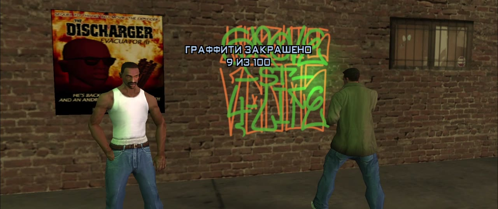

## What the mod does

### The story together

The host starts a mission, but it only begins once all players stand in the marker. If the partner reaches the
marker first, the host gets an invitation and presses Y to be there at once. The partners see the same texts,
subtitles, radar blips, markers, race checkpoints and timers, and the texts come in the language of each partner's
own game. The partners also hear the lines characters say during missions outside cutscenes. Weapons the mission
gives CJ go to the partners as well. When the story takes all of CJ's weapons, partners near the host lose theirs
too. Every player gets the mission reward. Enemies attack everyone, and any player can hurt them.

If the mission moves CJ somewhere else after a cutscene, the partner ends up next to the host. The mission's limits
on the wanted level apply to a partner near the host, and away from the host the wanted level works as usual. The
stars a mission gives CJ go to a partner near the host too. The gates and buildings a mission opens or changes change
for the partner too, as do the parts of the map a mission adds, such as the weed field in "Are You Going To San
Fierro?". The partner can also take the photos a mission asks for. A partner killed during a mission comes back next
to the host. The partner watches a mission's in-engine scenes through the same camera as the host.

The partner takes part in the missions themselves. They plant the charges in "Dam and Blast" and the bug in
"Amphibious Assault", drive a bike onto the truck in "Cop Wheels" and throw crates off the train in "Catalyst". They
see the missions' smoke, searchlight beams and sparks, and their shots raise the alarm. Any player can carry the
crates in the house robbery with Ryder and load them into the van. In the lowrider contest and the beach dance the
partner plays next to the host, and their points go into the shared score.

If the host gets on a bike or into a vehicle with no seat left, the partner is put straight into the same kind of
vehicle. In story missions the partner gets a plane or a helicopter of their own, such as the Hydra in "Vertical
Bird", and in Toreno's missions a jetpack of their own as well. In Zero's missions the partner gets a minigun of their
own next to the host's turret or an RC toy of their own: one with a gun or, in "New Model Army", with a magnet. A
partner far from Zero's shop gets the toy at its door. When the host is a gunner on a helicopter or a car, as in "The
Da Nang Thang" and "Reuniting the Families", the partner shoots beside them from the other side. If the host reaches a
mission's objective while the partner is still on the way, the mission waits for the partner up to 45 seconds.

| "Black Project": a jetpack for each player | The beach dance together, one shared score |
|---|---|
| 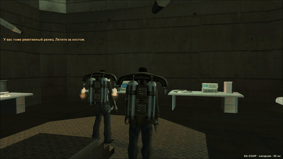 | 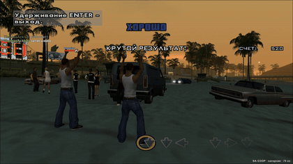 |

### Cutscenes

Cutscenes play for all players at the same time, and the partner is next to CJ in them. The partner walks with him:
follows CJ at a walking pace without jumping from spot to spot, and while standing listens to the conversation and
turns to whoever is talking. The paths for 130 cutscenes are worked out in advance from the game's map, and the second
and third partner have paths of their own. During drives the partner rides in the car with CJ if there is a seat. A
cutscene can only be skipped by everyone together: one player presses Enter, and the others agree with Enter or
refuse with Esc.

<p align="center">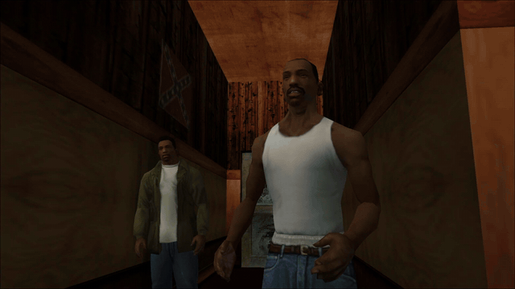</p>

### A shared world

All players have the same pedestrians, people inside buildings, cars and police, the same time of day and the same
weather. Pedestrians chat and swear the same way for everyone, and police roadblocks with their barriers are seen by
all. When one player drives away, the pedestrians and cars near another player move over to that player's game
instead of vanishing. Knocked-down lamp posts and signs, broken glass and crates, fire, gang territories, the building
doors a mission opens and the doors of Pay 'n' Spray and mod shops look the same for everyone. Horseshoes, oysters,
snapshots and tags count toward the shared world. New pedestrians and cars no longer appear right in front of another
player. Gang members from different players' games fight each other, the police chase whoever is wanted, and SWAT
officers slide down ropes from the helicopter for everyone. Police officers move the same way on every screen: they
hold a pistol in both hands, crouch to shoot and sidestep around their target. The police helicopter's gun fires on
every screen, and police cars no longer vanish for the partner when the host dies. Bodies and wrecks thrown by
explosions lie in the same places for everyone. Pool balls, shooting range targets and other activity objects are
seen by the other players.

### Cars

Each player drives on their own or rides as a passenger with another. A passenger can shoot from the window: the
right mouse button leans out with the gun, the left one fires. A passenger fires the RPG and the heat-seeking
launcher that way too, only without the lock-on. The driver also aims and fires anywhere while holding the right
mouse button, on a motorbike as well. Everyone in a car hears one radio: the driver changes the station, and the
passengers hear the same song from the same point. Tuning and damage are visible to the other players. Plane landing
gear and nozzles, tank and fire truck turrets, hydraulics, the horn, the police helicopter's searchlight, trailers,
the tow truck and the airport tug all work. Explosions, rockets, grenades, tank shells, fire truck water, NPC
drive-bys, trains and RC toys are seen by everyone. Any player can leave a car in the garage at a safe house or take
one out, and the host's world keeps them.

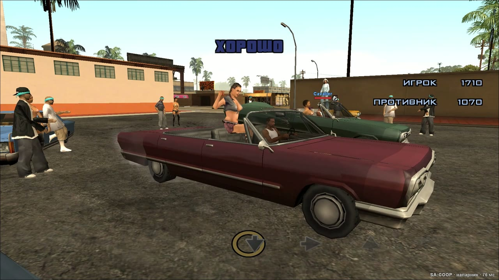

### Your own progress

Food and the gym, weapon skills, clothes, haircuts, tattoos and money are separate for each player. Driving,
motorbike, cycling and flying skills are shared: everyone has the best of the players' skills. The stats in the menu
are shared too. A side job or challenge completed by one player counts for everyone, reward included. The export list
at the docks is shared: a car one player delivers is crossed out for everyone, and everyone gets the money. What a
player does at a diner, the gym, a barber's or a tattoo parlour, the other players see as well, along with a tray of
food, a cigarette, a phone at the ear, a parachute jump, a fighting style learned at the gym, crouching with its
rolls, reloading and walking in through shop doors. If a player changes their character model, for example with a
skin selector, the others see the new model too.

The friend comes into the host's world as their own CJ, in the clothes and with the tattoos their CJ has in their own
game. If the friend joined from the main menu, the look comes from their latest save. When the host saves the game,
the friend's progress is saved on the host's side as well. The partner's school lessons and medals, side job levels,
gym, unique stunt jumps and businesses stay with the partner after the host's world is loaded again. When the host
loads a save, the partner's weapons become what they were at that save.

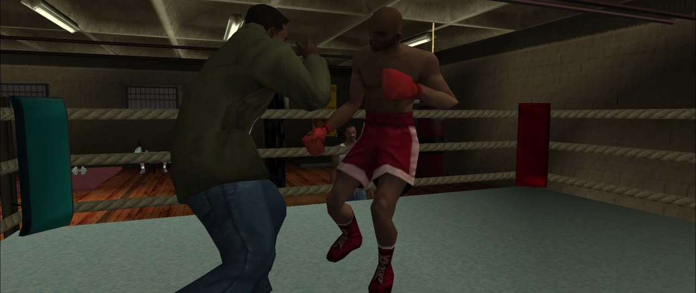

### Friendly fire

Before creating the game, the host can allow friendly fire with a checkbox in the F9 window. Then the players can
hurt and kill each other with bullets, fists, explosions, fire and cars. Without the checkbox they cannot harm
each other, and a stealth kill with a knife from behind does not work either. A player knocked down falls and gets up
on every screen. Next to it is the "Shared life" checkbox: with it, any player's death fails the host's story mission.
Without it, a host who dies gets up next to a partner a couple of seconds later and the mission goes on. It fails only
when everyone dies.

### Russian and English

The SA:COOP window, the chat and the hints come in Russian and English. The language switch is at the top of the
F9 window, and each player picks their own: the host can play in Russian while the partner plays in English.

### Animations

The U key opens the animations window. It holds 250 animations: emotions, poses, actions and dances from the game,
16 animations for two (handshakes, gang greetings, a hand on the shoulder, a deal, a gift, an argument, a kiss) and 88
animations from other authors' packs, among them Fortnite dances, breakdance and parkour. The tabs hold the main
animations of SA-MP role play servers: sitting, lying, smoking, eating, the phone, gestures. The chosen animation shows
at once in the window on a copy of your CJ, and the other players see it on your character. Your partner accepts an
animation for two with Y, and their CJ steps in front of yours. Poses, stances, dances and sitting last until you press
Space or F. A short animation stops at any movement. Your own animations from .ifp files go into the `coop/anims`
folder: another player sees them if they have the same file. The mod brings the pack animations along, and they load
on their own and replace nothing in the game.

<p align="center">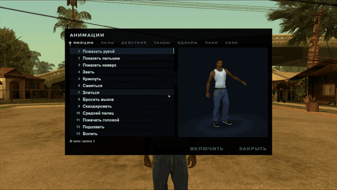</p>

### Side jobs and activities together

Side jobs (taxi, paramedic, firefighter, vigilante, pimp), races, schools, the shooting range, trucking and the
quarry are played by each player in their own game. A vehicle side job is started by whoever drives. A side job, a
race, a stadium event, the quarry, a valet shift or a shooting range round can be played together: within 20 seconds
of its start press Y, and the other players get an invitation (Y: yes, N: no). Whoever accepts sees its markers,
checkpoints, timers and hints, can ride along and help, for example put out burning cars or shoot the criminals, and
gets the same money at its end. The job's levels stay with the player who started it, and the reward for completing
the job goes to everyone. Taxi fares, stolen goods, trucking runs and quarry jobs count together for the reward.

In a joint race, a story race too, the second player races as well, with their own checkpoints and their own place on
the screen. Whoever rides with a racer sees the racer's place. Pool for two is played for money: the loser gives the
stake to the winner. Two players can be at one school at once: during a lesson the other player's car is not shown
and does not get in the way.

| Firefighters together | Pool for two, for money |
|---|---|
| 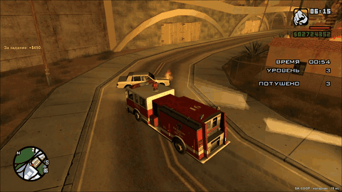 | 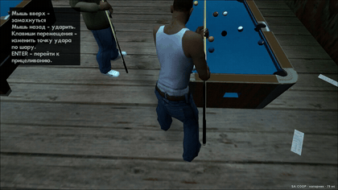 |

### Everything else

There is text chat and voice chat, and the farther away the partner is, the quieter they sound. A waypoint one player
sets on the map shows up on the other players' radar, and a house one player buys appears for everyone. Above the
partner's head you see their health, armour, weapon and wanted stars, shown over their RC toy while they fly one.
Turf wars near the host are the host's, and all players' kills of rival gang members provoke them. A partner more
than 100 m from the host can start a war of their own, and the host sees in the chat which district it is for and how
it ended. Cheats for the weather, traffic, pedestrians and game speed work for everyone, while weapon, money and
health cheats only work for the player who typed them. Theme cheats such as the beach party change the pedestrians
for everyone, but only the player who typed the code gets the outfit and the katana.

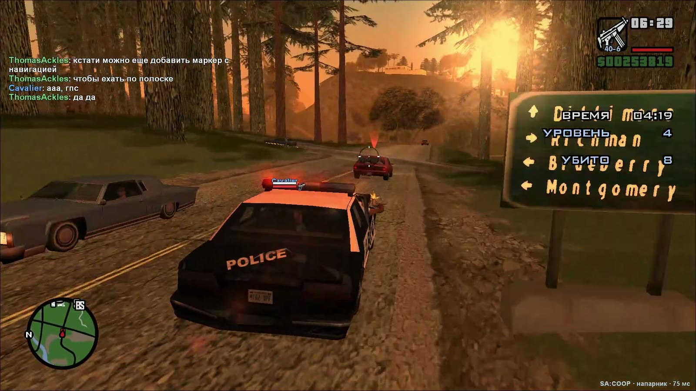

## Installation

You need GTA San Andreas version 1.0 US, either clean or a modded build. If your game comes from Steam or the
Rockstar Games Launcher, downgrade it to 1.0 US first, for example with GTA SA Downgrader.

1. Download `SA-COOP.zip` from the [Releases](../../releases) page and unpack it into the game folder so that
   `coop.asi`, `install.bat` and the `coop` folder end up next to `gta_sa.exe`.
2. Run `install.bat`. In a clean game it installs an ASI plugin loader, and in a build that already has one (for
   example, the one Widescreen Fix brings) it changes nothing.
3. Start the game. The SA:COOP window opens in the main menu, and later you can bring it up with F9. Enter your
   nickname. To switch the window to English, click EN at the top of it.

The archive also contains a detailed player guide in Russian, `Инструкция.txt`.

To update, unpack the new archive over the old files. Your settings and the partners' progress stay, and you don't
need to run `install.bat` again. All players need to update: different versions of the mod do not connect to each
other.

## How to play

The host presses F9, opens the "Host a game" tab, picks a save and clicks "Start the server". If the host is
already in the game, the server is created from the current game. Beside the password the host chooses how many will
play: 2, 3 or 4. The "Friendly fire" checkbox above the button lets the players hurt each other. A couple of seconds
later the window shows a code like `XXXX-XXXX-XXXX`, which the host sends to the friends. The code contains the host's
external IP address, so only send it to the people you play with.

The friend opens the "Join a game" tab, pastes the code and clicks "Connect". After that, the host's world loads
on the friend's side.

<p align="center">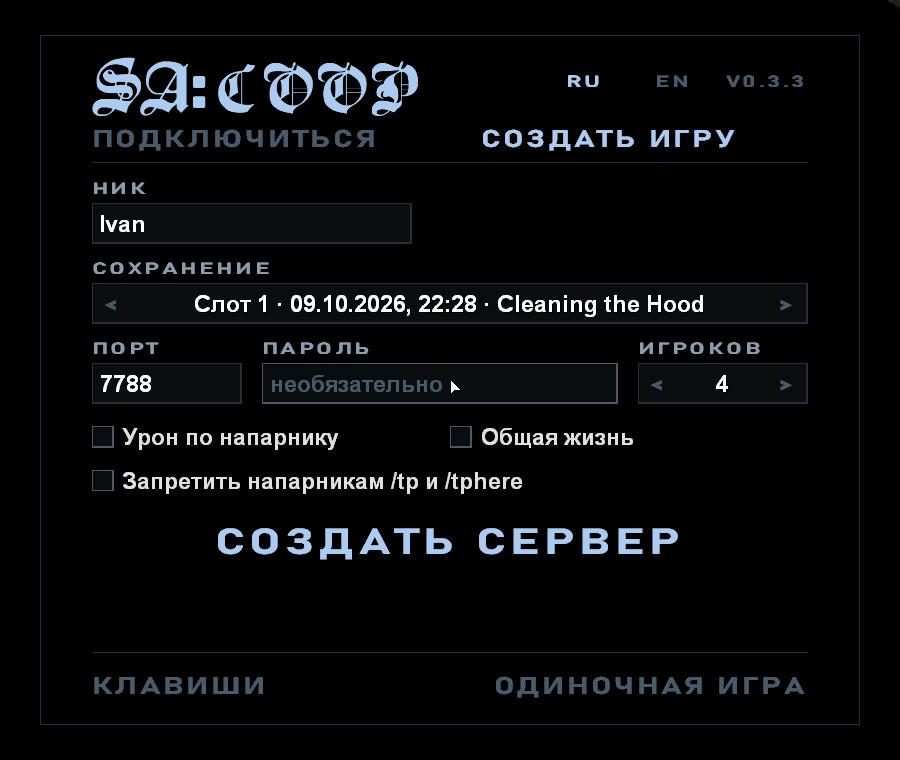</p>

The picture shows the window in Russian. EN at the top switches it to English.

You can also start the story from the very beginning: the last item in the save list is "New game". The host
plays the prologue alone, while the friend connects right away and waits. When CJ gets on the bike, the friend
appears next to him, and there is a bike for the friend too. The friend's money, weapons, skills and look start
over in a new game too. When the host goes back to an older save, the friend has everything they had in that game.
When the host loads a save, the friend's weapons become what they were at that save.

You don't need Hamachi or Radmin. The server opens its port through UPnP or punches through NAT. If neither works
with your internet providers, the host can turn on a relay with the `turn` line in `coop\server.ini`, as the
guide describes.

When the host creates a game, the mod checks Windows Firewall. If it would keep friends from the server, Windows
asks to allow changes, and after "Yes" the mod allows `coop-server.exe` on every network. Without that the friend
sees "The server does not answer", even on a home network. If an antivirus removed or blocked `coop.asi` or
`coop-server.exe`, add the game folder to its exclusions and unpack the archive again.

## Keys

| Key | What it does |
|---|---|
| F9 | the SA:COOP window |
| T | chat: Enter sends a message, Esc closes the chat |
| B | voice chat while the key is held (the mode is set in the F9 window) |
| G | get into the nearest car as a passenger, by the nearest door |
| Triangle (hold) | on a gamepad: get in as a passenger |
| Right mouse button | in a vehicle with a gun: lean out and aim, fire with the left button |
| F2 | the players: money, giving money and weapons, and with more than two players their numbers and /tp and /tphere by a click |
| U | animations: emotions, poses, actions, dances, animations for two and your own |
| F7 | hide the interface and bring it back |
| Enter / Esc | in a cutscene: offer to skip it, agree / refuse |

The chat supports the `/help`, `/players`, `/tp` (go to your partner unless they are inside a building) and `/tphere`
(bring your partner over) commands. With more than two players the command takes the player's number: `/tp 2`,
`/tphere 3`. The F2 window shows the numbers. Your partner answers `/tp` and `/tphere` with Y or N. The host can kick a player
with `/kick <nickname> [reason]` and, creating the game, turn `/tp` and `/tphere` off for partners.
The `/anims` command opens the animations window, and `/anims` with a number plays that animation at once.

<p align="center">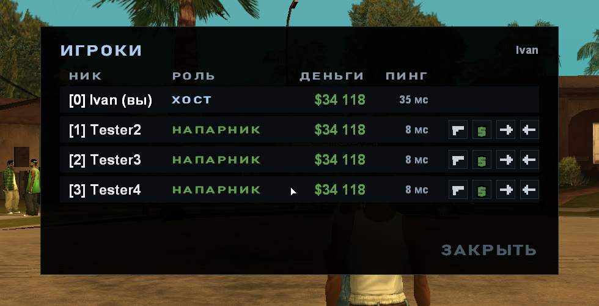</p>

The chat, passenger, player list and voice keys can be changed in the F9 window, the "Keys" button. The microphone's
mode is picked there too: while the key is held, a press turns it on and off, always on or off. The `[game]` section
of `coop\coop.ini` can hide the partner's radar mark (`partner_blip = 0`) and the name tag over their head
(`name_tags = 0`), for a shoot-out where you have to find each other. `gps = 0` there turns off the road route to
the map waypoint or the mission's destination that the radar shows in a vehicle. Change the keys if, say, T gets in the way of typing cheat
codes.

Three more lines help to record video in windowed mode (`windowed = 1`). `borderless = 1` takes the frame off the
window, so a window the size of the screen looks like a fullscreen game. `window_title = ...` gives the window a title
of its own, which lets recording software tell one copy of the game from another. `clean_screen = 1` in the `[debug]`
section clears everything the mod draws: the chat, the names over the players and the windows.

## Limitations

- The partner's girlfriend progress is not kept: it comes from the host's world. The income of the partner's
  businesses lies in the shared world, and any player can pick it up, as with the host's.
- Story missions and Cesar's races run in the host's game: a mission does not begin without the host in the marker.
  With three or four players it begins once they all stand in the marker.
- Pool and contests are for two. The others meanwhile do something of their own or watch.
- During the host's story mission the partner cannot get into the host's trains. Outside missions any player can
  get into a train another player is not driving and drive it.
- The partner gets story progress (new areas, gyms) by loading the host's world. This happens in the next
  mission's marker, or after 10 minutes without missions, and takes a couple of seconds. The partner keeps their
  position, weapons and progress.
- The host keeps the partner's profile under the partner's nickname. With a different nickname, money and skills
  start over.
- The Ammu-Nation clerk, the shooting range's shooters, the casino dealers and other people that shop and activity
  scripts place are made by each game for its own player. Different players may see them looking different.
- Whatever gets knocked down or broken on the streets stays that way for a few minutes, then the map puts
  everything back, as in the normal game.
- If the host and the partner are both behind a "symmetric" NAT (common with mobile internet), the invite code cannot
  connect them without a relay. Then you need `turn` or port 7788/UDP forwarded to the host's computer.
- Each player hears their own User Track Player. When the driver plays their own music, the passenger hears
  their own, or the radio is off for them if they have none.
- Only `gta_sa.exe` version 1.0 US is supported. The players' builds may differ, but mods that change the story or
  the saves are needed by everyone. If the partner's `data\script\main.scm` differs from the host's, the host's
  world does not load for them, and the mod says so in the chat.
- Mods installed through modloader work. Each player sees their own models, textures and effects. A car that a mod
  adds under a new ID is only visible to the player who has that mod.

## Bugs and ideas

Report bugs, crashes and ideas in [Issues](../../issues/new/choose). A short form opens there: what happened, how
to make it happen again, the mod version and which game you have. The form is in Russian, but you can answer in
English. A [Telegram group](https://t.me/sacoop_forum) is also available if you encounter difficulties sending to GitHub.

With a bug report, attach `coop\coop.log` from the game folder of the player who had the problem. If the game
crashed, also attach `coop\crash.log`, and if you cannot connect, attach the host's `coop\server-data\server.log`.
The log of the previous run is kept as `coop\coop.old.log`: send it if the game was started again after a crash.

## Building from source

You need Windows, Python 3.10 or newer and PowerShell. A script downloads the compiler (llvm-mingw) into the
`toolchain` folder:

```
powershell -ExecutionPolicy Bypass -File tools/get-toolchain.ps1
python tools/build.py          # coop.dll, coop-server.exe and vorbisFile.dll in build/release/bin
python tools/build.py dist     # the same plus the ready archive dist/SA-COOP.zip
python tools/fsd_check.py      # checks the dependencies between the layers
python tools/i18n_check.py     # checks that every text of the game has its English one
```

GitHub Actions builds every push and keeps the archive in the build artifacts. A tag like `v0.2.0` publishes a
release with `SA-COOP.zip` attached.

## Project layout

The sources follow Feature-Sliced Design. Each of the three programs is a separate application with the layers
`app`, `pages`, `widgets`, `features`, `entities` and `shared`, and the code they share lives in `src/common`.

```
src/
├── client/        coop.asi, runs inside the game
│   ├── app/       entry point, main loop, game patches
│   ├── pages/     the F9 window
│   ├── widgets/   the overlay on top of the game
│   ├── features/  story and cutscenes, progress, garages, voice, weather and more
│   ├── entities/  session, player, vehicle, ped, mission, profile
│   └── shared/    engine wrappers, network, drawing and input, config
├── server/        coop-server.exe, the server for 2 to 4 players
├── loader/        vorbisFile.dll, the ASI loader for a clean game
└── common/        protocol, network, log and utilities for all three
```

A layer only includes the layers below it and its own slice, which `tools/fsd_check.py` checks. How the mod works
inside and why it is built this way is described in [docs/ARCHITECTURE.md](docs/ARCHITECTURE.md) (in Russian).

## Third-party code

- [ENet](http://enet.bespin.org) (MIT license): network transport, `third_party/enet`.
- [MinHook](https://github.com/TsudaKageyu/minhook) (BSD 2-Clause license): function hooking, `third_party/minhook`.
- [Font Awesome Free](https://fontawesome.com) (CC BY 4.0 license): the voice chat's microphone icon,
  `src/client/features/voice/ui/microphone.svg`.
- [llvm-mingw](https://github.com/mstorsjo/llvm-mingw): the compiler, downloaded during the build.
- The Packs tab's animations (`package/coop/packs`) come from other authors' mods, only the new animations of each:
  Salute by KOT33 ([LibertyCity](https://libertycity.net/files/gta-san-andreas/94399-salute.html)), the GTA V greeting by Alexander (Skone Modding)
  ([LibertyCity](https://libertycity.net/files/gta-san-andreas/98406-military-greeting-mod-gta-v-to-sa.html)), rap by Aleksey_Move
  ([LibertyCity](https://libertycity.net/files/gta-san-andreas/79275-animation-rapping.html)), poses by Androsz and mrandres5555
  ([LibertyCity](https://libertycity.net/files/gta-san-andreas/132610-new-static-animations.html)), poses on the ground by Ruslan Konorov
  ([LibertyCity](https://libertycity.net/files/gta-san-andreas/132637-static-animations.html)), idle actions from GTA LCS converted by Mystertv and Junior_Djjr
  ([LibertyCity](https://libertycity.net/files/gta-san-andreas/140391-new-idle-animations-from-gta-lcs.html)), disco dances by GRAF MC
  ([1](https://libertycity.net/files/gta-san-andreas/119882-anim-dance.html), [2](https://libertycity.net/files/gta-san-andreas/127294-anim-dance-v2.html)), Fortnite dances by Sergio Persson
  ([LibertyCity](https://libertycity.net/files/gta-san-andreas/168251-dances-from-fortnite-music-v.2.html)), party dances by ATField02_GR
  ([LibertyCity](https://libertycity.net/files/gta-san-andreas/242533-new-dance-animations.html)), breakdance and tricks by Arch
  ([LibertyCity](https://libertycity.net/files/gta-san-andreas/26294-new-moves-breakdance-somersaults-and-more.html)), acrobatics by Spirit
  ([LibertyCity](https://libertycity.net/files/gta-san-andreas/34680-acrostreet-and-tricking-mod-v1.html)), parkour by Paul_Cortez
  ([MTA wiki](https://wiki.multitheftauto.com/wiki/EngineLoadIFP)).
- Engine addresses and structures were checked against [gta-reversed](https://github.com/gta-reversed/gta-reversed)
  and [plugin-sdk](https://github.com/DK22Pac/plugin-sdk).

## License

The SA:COOP code is released under the MIT license (see [LICENSE](LICENSE)). ENet, MinHook and the Font Awesome
icon have their own licenses, and their texts are in `third_party` and in the `coop\licenses` folder of the archive.

SA:COOP is not affiliated with Rockstar Games or Take-Two Interactive. You need your own copy of GTA San Andreas,
and the repository contains no game files.
