<p align="center">
  
</p>

<p align="center">
  <a href="https://github.com/Karimov-Akbar/sa-coop/releases/latest"></a>
  <a href="https://github.com/Karimov-Akbar/sa-coop/releases"></a>
  <a href="https://github.com/Karimov-Akbar/sa-coop/actions/workflows/build.yml"></a>
  <a href="LICENSE"></a>
  
  <a href="https://t.me/cavalier_mods"></a>
  <a href="https://dalink.to/itscavalier"></a>
</p>

<p align="center"><b>Русский</b> · <a href="README.en.md">English</a></p>

SA:COOP - мод для GTA San Andreas, с которым сюжет можно пройти вдвоём, втроём или вчетвером по сети. Один игрок
становится хостом: игра идёт по его сохранению, и миссии запускает он. Остальные подключаются к нему и играют в том же
мире своими персонажами, со своими деньгами, навыками и внешностью.

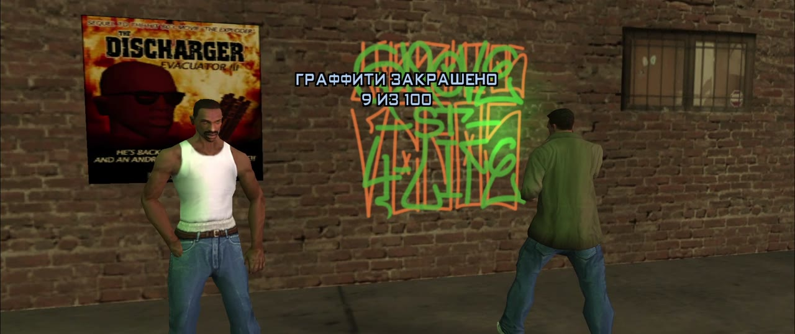

## Что умеет мод

### Сюжет вместе

Миссию запускает хост, но начинается она, только когда в маркер встали все игроки. Если напарник пришёл в маркер
первым, хост видит приглашение и по Y сразу оказывается рядом с ним. Напарники видят те же тексты, субтитры, метки на
радаре, маркеры, гоночные чекпоинты и таймеры, причём тексты идут на языке их собственной игры. Реплики, которые
персонажи говорят в миссиях вне катсцен, они тоже слышат. Оружие, которое миссия выдаёт CJ, получают и напарники.
Если сюжет отбирает у CJ всё оружие, напарники рядом с хостом тоже его теряют. Награду за миссию получают все. Враги
нападают на всех, и ранить их может каждый.

Если после катсцены миссия переносит CJ в другое место, напарник оказывается рядом с хостом. Ограничения миссии на
розыск действуют на напарника рядом с хостом, а вдали от него розыск идёт как обычно. Звёзды, которые миссия даёт CJ,
получает и напарник рядом с хостом. Ворота и здания, которые миссия открывает или меняет, меняются и у напарника.
Части карты, которые миссия добавляет, тоже появляются у всех, например поле конопли в «Are You Going To San
Fierro?». Снимки, которые нужны миссии, может делать и напарник. Убитый во время миссии напарник возвращается рядом с
хостом. Сцены миссий на движке игры напарник смотрит той же камерой, что и хост.

Напарник участвует в самих миссиях. Он ставит заряды в «Dam and Blast» и жучок в «Amphibious Assault», везёт
мотоцикл на фуру в «Cop Wheels» и бросает ящики с поезда в «Catalyst». Он видит дым, лучи прожекторов и искры миссий,
а от его выстрелов поднимается тревога. Ящики в ограблении дома с Райдером может носить и грузить в фургон любой
игрок. В конкурсе лоурайдеров и в танце на пляже напарник играет рядом с хостом, и его очки идут в общий счёт.

Если хост сел на мотоцикл или в машину без свободного места, напарник сразу садится в такой же транспорт. В сюжетных
миссиях он получает свой самолёт или вертолёт, например Hydra в «Vertical Bird», а в миссиях Торено ещё и свой
реактивный ранец. В миссиях Зеро у напарника свой пулемёт рядом с турелью хоста или своя игрушка на радиоуправлении:
с пулемётом или, в «New Model Army», с магнитом. Если напарник далеко от магазина Зеро, игрушку он получает у его
двери. Когда хост стреляет с вертолёта или машины, как в «The Da Nang Thang» и «Reuniting the Families», напарник
стреляет рядом с другой стороны. Если хост дошёл до цели миссии, а напарник ещё в пути, миссия ждёт его до 45 секунд.

<p align="center">
  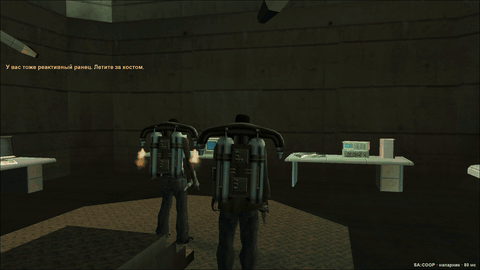
  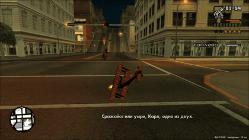
  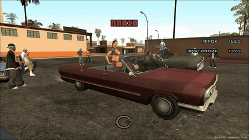
  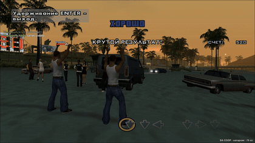
</p>

### Катсцены

Катсцены идут у всех одновременно, и напарник в них рядом с CJ. Он ходит вместе с ним: идёт за CJ шагом, не
перескакивает с места на место, а на месте слушает разговор и поворачивается к тому, кто говорит. Путь для 130
катсцен рассчитан заранее по карте игры, и у второго и третьего напарника пути свои. В поездках напарник сидит с CJ в
машине, если в ней есть место. Пропустить катсцену можно только всем вместе: один нажимает Enter, остальные
соглашаются тем же Enter или отказываются клавишей Esc.

<p align="center">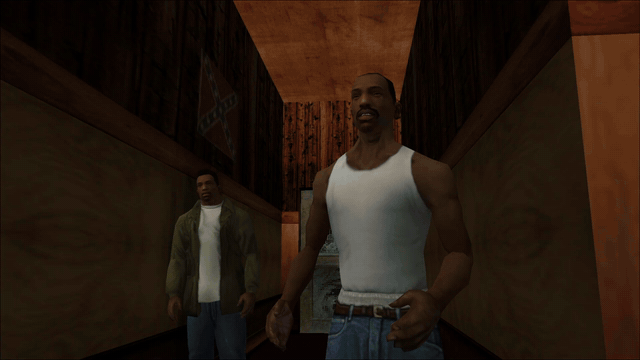</p>

### Общий мир

У всех игроков одни и те же прохожие, люди внутри зданий, машины и полиция, одинаковые время суток и погода. Прохожие
переговариваются и ругаются у всех одинаково, а полицейские заграждения с барьерами видны всем. Когда один игрок
уезжает, прохожие и машины рядом с другим переходят в его игру и никуда не пропадают. Сбитые фонари и знаки,
разбитые стёкла и ящики, огонь, территории банд, двери зданий, которые открывает миссия, и ворота Pay 'n' Spray и
мастерских выглядят у всех одинаково. Подковы, устрицы, снимки и граффити засчитываются в общий мир. Новые прохожие
и машины не появляются перед глазами другого игрока. Банды из игр разных игроков дерутся между собой, полиция
гонится за тем, кого разыскивают, а бойцы SWAT спускаются с вертолёта по тросу у всех. Полицейские на всех экранах
двигаются одинаково: держат пистолет двумя руками, стреляют присев и обходят цель боком. Пулемёт полицейского
вертолёта стреляет у всех, а полицейские машины не исчезают у напарника, когда хост погиб. Тела убитых и обломки
машин после взрывов лежат у всех в одних и тех же местах. Шары на бильярдном столе, мишени тира и другие предметы
занятий видны другим игрокам.

### Машины

Каждый водит сам или садится пассажиром к другому. Пассажир стреляет из окна: правая кнопка мыши высовывает его с
оружием, левая стреляет. Пассажир стреляет так и из РПГ и самонаводящейся ракетницы, только без наведения на цель.
Водитель тоже целится и стреляет куда угодно, пока держит правую кнопку мыши, в том числе на мотоцикле. Радио в
машине у всех одно: станцию переключает водитель, а пассажиры слышат ту же песню с того же места. Тюнинг и
повреждения видны другим игрокам. Работают шасси и сопла самолётов, башни танка и пожарной машины, гидравлика, гудок,
прожектор полицейского вертолёта, прицепы, эвакуатор и тягач в аэропорту. Взрывы, ракеты, гранаты, выстрелы танка,
вода из пожарной машины, стрельба NPC из машин, поезда и радиоуправляемые модели видны всем. Машину в гараже у дома
может оставить и забрать любой игрок, а хранит её мир хоста.

<p align="center">
  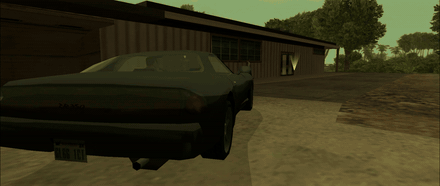
  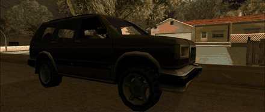
</p>

### Своя прокачка

Еда и спортзал, навыки оружия, одежда, стрижки, тату и деньги у каждого свои. Навыки вождения машины, мотоцикла,
велосипеда и самолёта общие: у всех самый высокий навык среди игроков. Статистика в меню тоже общая. Подработка или испытание,
пройденные одним игроком, засчитываются всем вместе с наградой. Список экспорта в порту общий: машина, сданная одним,
вычёркивается у всех, а деньги за неё получают все. Что игрок делает в закусочной, спортзале, парикмахерской или
тату-салоне, другие видят у себя, как и поднос с едой, сигарету, телефон у уха, прыжок с парашютом, стиль боя,
выученный в спортзале, присед с кувырками, перезарядку и проход в двери магазинов. Если игрок сменит модель
персонажа, например скинселектором, другие тоже увидят новую модель.

Друг приходит в мир хоста своим CJ, в той одежде и с теми тату, что у него в его игре. Если он подключился из главного
меню, облик берётся из его последнего сохранения. Когда хост сохраняет игру, прогресс друга сохраняется у хоста тоже.
Уроки и медали автошколы и других школ, уровни подработок, спортзал, уникальные трюки и бизнесы напарника остаются при
нём и после того, как мир хоста загружается заново. Когда хост загружает сохранение, оружие напарника возвращается к
тому, что было при этом сохранении.

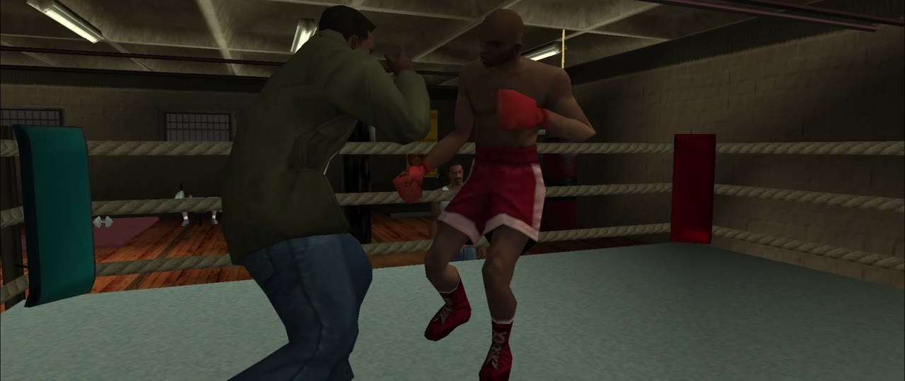

### Урон по напарнику

Хост может разрешить урон по напарнику галочкой в окне F9, перед тем как создать игру. Тогда игроки ранят
и убивают друг друга пулями, кулаками, взрывами, огнём и машиной. Без галочки они друг для друга неуязвимы,
и тихое убийство ножом со спины тоже не срабатывает.
Сбитый с ног игрок падает и поднимается на всех экранах. Рядом есть галочка «Общая жизнь»: с ней гибель
любого из вас проваливает сюжетную миссию хоста. Без неё погибший хост через пару секунд встаёт рядом с напарником,
и миссия идёт дальше. Провалится она, только если погибли все.

### Русский и английский

Окно SA:COOP, чат и подсказки есть на русском и английском. Язык переключается вверху окна F9, и каждый
выбирает его себе сам: у хоста может быть русский, а у напарника английский.

### Анимации

Клавиша U открывает окно анимаций. В нём 250 анимаций: эмоции, позы, действия и танцы из игры, 16 анимаций вдвоём
(рукопожатия, приветствия банды, рука на плечо, сделка, подарок, спор, поцелуй) и 88 анимаций из паков других
авторов, среди них танцы из Fortnite, брейк и паркур. Во вкладках основные анимации, как на RP-серверах SA-MP: сесть,
лечь, курить, есть, телефон, жесты. Выбранная анимация сразу показывается в окне на копии вашего CJ, а другие игроки
видят её на вашем персонаже. Анимацию вдвоём напарник принимает клавишей Y, и его CJ встаёт напротив вашего. Позы,
стойки, танцы и сидения держатся, пока не нажмёте пробел или F. Короткие анимации останавливает любое движение. Свои
анимации из файлов .ifp кладутся в папку `coop/anims`: другой игрок видит их, если у него лежит такой же файл.
Анимации паков мод привозит сам, они грузятся отдельно и ничего в игре не заменяют.

<p align="center">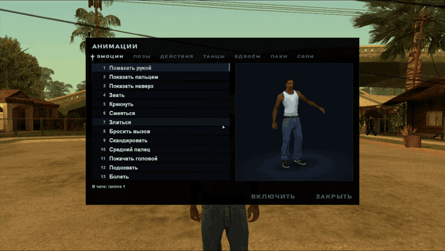</p>

### Подработки и занятия вместе

Подработки (такси, скорая, пожарные, полиция, сутенёр, курьер), гонки, школы, тир, грузоперевозки и карьер каждый
проходит в своей игре. Подработку в машине начинает тот, кто за рулём. Подработку, гонку, стадион, карьер, смену парковщика или
тир можно пройти вместе: в первые 20 секунд после начала нажмите Y, и другим игрокам придёт приглашение (Y: да,
N: нет). Согласившиеся видят её метки, чекпоинты, таймеры и подсказки, могут ехать рядом и помогать, например тушить
машины или стрелять по преступникам, а в конце получают столько же денег. Уровни подработки остаются у того, кто её
начал, а награду за полное прохождение получают все. Поездки такси, украденное, рейсы грузовиков и задания карьера
для награды считаются общими.

В совместной гонке, в том числе сюжетной, соревнуется и второй игрок: у него свои чекпоинты и своё место на экране.
Кто едет с гонщиком, видит его место в гонке. Бильярд вдвоём идёт на деньги: проигравший отдаёт ставку победителю. В
школу можно идти вдвоём разом: пока вы учитесь, машины другого не видно и она не мешает.

<p align="center">
  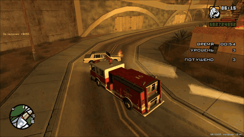
  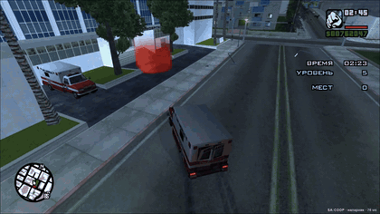
  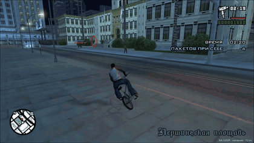
  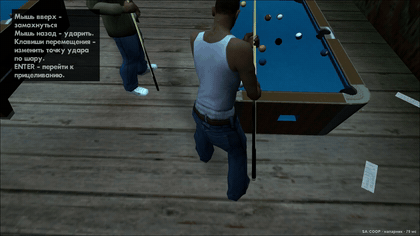
</p>

Занятие можно превратить в соревнование. В первые 20 секунд после начала нажмите U, и другим игрокам придёт вызов
(Y: да, N: нет). Кто первым согласится, играет то же самое в своей игре. Пока соревнование идёт, вверху экрана видны
результаты обоих, а в конце каждый узнаёт, кто победил. Соревноваться можно в баскетболе, бильярде, блэкджеке, рулетке,
колесе фортуны, танцах в клубе, конкурсе лоурайдеров, на стадионах, в гонках и триатлоне.

<p align="center">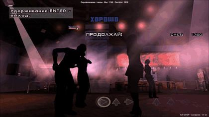</p>

### Остальное

Есть текстовый чат и голос, причём чем дальше напарник, тем тише его слышно. Метку на карте другие игроки видят у
себя на радаре, а купленный дом появляется у всех. Над головой напарника видны его здоровье, броня, оружие и звёзды
розыска, а когда он ведёт игрушку на радиоуправлении, всё это видно над игрушкой. Войну за территорию рядом с хостом
ведёт хост, а провоцировать её убийствами бандитов можно вместе. Напарник дальше 100 м от хоста может начать свою
войну, и хост увидит в чате, за какой район она идёт и чем кончилась. Чит-коды на погоду, трафик, прохожих и скорость
игры действуют у всех, а на оружие, деньги и здоровье только у того, кто их ввёл. Тематические коды вроде пляжной
вечеринки меняют прохожих у всех, а одежду и катану получает только тот, кто ввёл код.

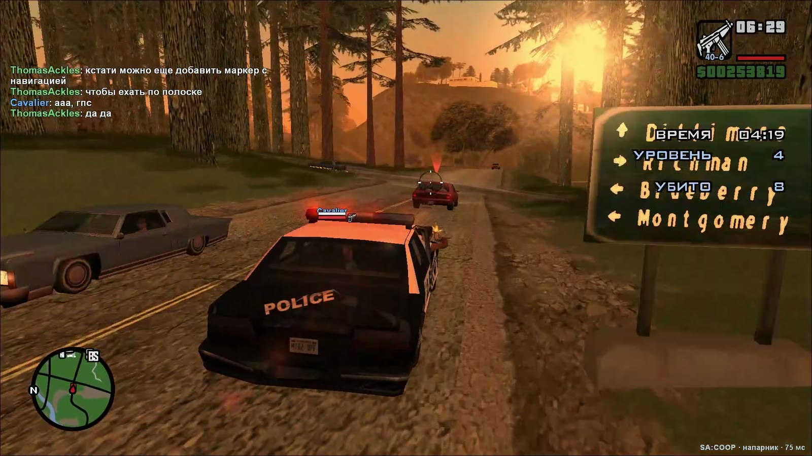

## Установка

Нужна GTA San Andreas версии 1.0 US, чистая или сборка с модами. Если игра куплена в Steam или Rockstar Games
Launcher, её сначала надо откатить до 1.0 US, например программой GTA SA Downgrader.

1. Скачайте архив `SA-COOP.zip` со страницы [Releases](../../releases) и распакуйте его в папку игры, чтобы
   `coop.asi`, `install.bat` и папка `coop` оказались рядом с `gta_sa.exe`.
2. Запустите `install.bat`. В чистой игре он поставит загрузчик ASI-плагинов, а в сборке, где загрузчик уже
   есть (например, из Widescreen Fix), ничего не изменит.
3. Запустите игру. Окно SA:COOP откроется в главном меню, а потом его можно вызвать клавишей F9. Впишите ник.

Подробная инструкция для игроков лежит в архиве в файле `Инструкция.txt`.

Чтобы обновиться, распакуйте новый архив поверх старых файлов. Настройки и прогресс напарника останутся, а
`install.bat` второй раз запускать не нужно. Обновиться нужно всем игрокам: разные версии мода друг к другу не
подключаются.

## Как играть

Хост нажимает F9, открывает вкладку «Создать игру», выбирает сохранение и нажимает «Создать сервер». Если он уже
в игре, сервер создаётся из текущей игры. Рядом с паролем хост выбирает, сколько будет игроков: 2, 3 или 4. Галочка
«Урон по напарнику» над кнопкой разрешает игрокам ранить друг друга. Через пару секунд в окне появится код вида
`XXXX-XXXX-XXXX`. Его нужно отправить друзьям. В коде зашит внешний IP хоста, поэтому отправляйте его только тем, с кем
играете.

Друг на вкладке «Подключиться» вставляет код и нажимает «Подключиться». После этого у него загружается мир хоста.
Язык переключается вверху окна, там, где RU и EN.

<p align="center">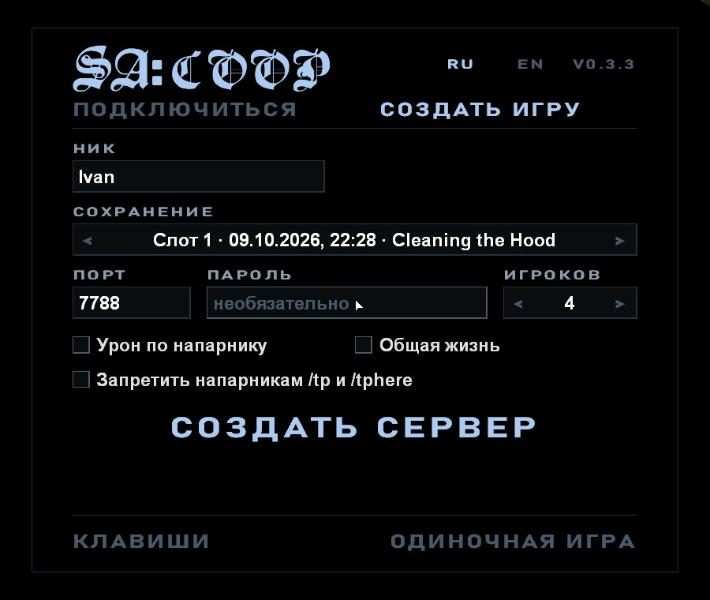</p>

Сюжет можно начать и с самого начала: последний пункт в списке сохранений называется «Новая игра». Пролог хост
проходит один, а друг подключается сразу и ждёт. Когда CJ сядет на велосипед, друг появится рядом с ним, и для
него тоже найдётся велосипед. Деньги, оружие, навыки и внешность друга в новой игре тоже начинаются с нуля. Когда
хост вернётся к старому сохранению, у друга будет всё, что он набрал в той игре. Оружие друга при загрузке сохранения
становится таким, каким было при этом сохранении.

Hamachi и Radmin не нужны. Сервер сам открывает порт через UPnP или пробивает NAT. Если у провайдеров не проходит
ни то, ни другое, хост может включить ретранслятор строкой `turn` в `coop\server.ini`, как описано в инструкции.

Когда хост создаёт игру, мод проверяет брандмауэр Windows. Если тот не пустит друзей к серверу, Windows спросит
разрешение на изменения, и после «Да» мод разрешит `coop-server.exe` во всех сетях. Без этого друг видит «Сервер не
отвечает», даже по локальной сети. Если антивирус удалил или заблокировал `coop.asi` или `coop-server.exe`,
добавьте папку игры в исключения и распакуйте архив заново.

## Клавиши

| Клавиша | Что делает |
|---|---|
| F9 | окно SA:COOP |
| T | чат: Enter отправляет сообщение, Esc закрывает |
| B | голосовая связь, пока клавиша зажата (режим меняется в окне F9) |
| G | сесть пассажиром в ближайшую машину через ближайшую дверь |
| Треугольник (удерживать) | на геймпаде: сесть пассажиром |
| Правая кнопка мыши | в машине с оружием: высунуться и целиться, стрелять левой кнопкой |
| F2 | игроки: деньги, передача денег и оружия, а если игроков больше двух, ещё номера игроков и /tp и /tphere кнопками |
| U | анимации: эмоции, позы, действия, танцы, анимации вдвоём и свои |
| F7 | спрятать интерфейс и вернуть его |
| Enter / Esc | в катсцене: предложить пропуск и согласиться / отказаться |

В чате работают команды `/help`, `/players`, `/tp` (переместиться к напарнику, если он не в здании) и `/tphere`
(позвать напарника к себе). Если игроков больше двух, после команды пишется номер игрока: `/tp 2`, `/tphere 3`. Номера
видны в окне F2. На `/tp` и `/tphere` напарник отвечает Y или N. Хост может выгнать игрока командой
`/kick <ник> [причина]`, а при создании игры запретить напарникам `/tp` и `/tphere`.
Команда `/anims` открывает окно анимаций, а `/anims` с номером сразу включает анимацию с этим номером.

<p align="center">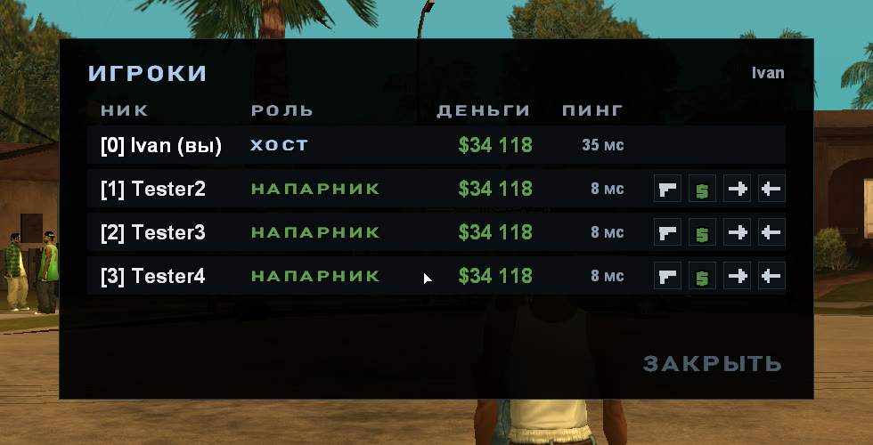</p>

Клавиши чата, посадки пассажиром, списка игроков и голоса меняются в окне F9, кнопка «Клавиши». Там же
выбирается, как работает микрофон: пока клавиша зажата, включается и выключается нажатием, всегда включён или
выключен. Это пригодится, если T мешает вводить чит-коды. В `coop\coop.ini`, в разделе `[game]`, можно убрать метку напарника с радара (`partner_blip = 0`)
и подпись над его головой (`name_tags = 0`), например чтобы искать друг друга в перестрелке. Путь по дорогам до
метки на карте или цели миссии, который в машине рисуется на радаре, выключает `gps = 0`.

Для записи видео в оконном режиме (`windowed = 1`) есть ещё три строки. `borderless = 1` убирает у окна рамку, и
окно размером с экран выглядит как полноэкранная игра. `window_title = ...` задаёт окну свой заголовок, по нему
программа записи отличит одну копию игры от другой. `clean_screen = 1` в разделе `[debug]` убирает с экрана всё,
что рисует мод: чат, подписи над игроками и окна.

## Ограничения

- Сюжетные миссии и гонки Сезара идут в игре хоста: без хоста в маркере миссия не начнётся. Если игроков трое или
  четверо, миссия начнётся, когда в маркере встанут все.
- Бильярд и соревнования идут на двоих. Остальные в это время заняты своим или смотрят.
- Во время сюжетной миссии хоста напарник не может сесть в поезд хоста. Вне миссий в поезд, которым не управляет
  другой игрок, можно сесть и вести его.
- Сюжетный прогресс (новые районы, качалки) напарник получает загрузкой мира хоста. Она идёт в маркере
  следующей миссии или, если миссий нет, через 10 минут и занимает пару секунд, а место, оружие и прокачка
  напарника сохраняются.
- Профиль напарника хранится у хоста под его ником. С другим ником деньги и навыки начинаются заново.
- Отношения с подругами у напарника не сохраняются: они идут от мира хоста. Доход от бизнеса напарника лежит
  в общем мире, и забрать его может любой игрок, как и доход хоста.
- Продавца Ammu-Nation, стрелков тира, крупье и других людей, которых ставят скрипты магазинов и занятий, каждая
  игра создаёт для своего игрока сама. У разных игроков они могут выглядеть по-разному.
- Сбитое и сломанное на улицах держится несколько минут, потом карта ставит всё на место, как в обычной игре.
- Если хост и напарник оба за «симметричным» NAT (так бывает в мобильном интернете), без ретранслятора по коду не
  подключиться. Тогда нужен `turn` или проброшенный у хоста порт 7788/UDP.
- Поддерживается только `gta_sa.exe` версии 1.0 US. Сборки у игроков могут отличаться, но моды, которые
  меняют сюжет или сохранения, нужны всем. Если `data\script\main.scm` у напарника не такой, как у хоста,
  мир хоста у него не загрузится, и мод скажет об этом в чате.
- Свою музыку (User Track Player) каждый слышит свою. Если водитель включил свою, пассажир слышит свою, а без
  неё радио у него выключено.
- Моды через modloader работают. Модели, текстуры и эффекты каждый видит свои. Машину, которую мод добавляет
  под новым номером, видит только тот, у кого этот мод стоит.

## Ошибки и предложения

Об ошибках, вылетах и идеях пишите в [Issues](../../issues/new/choose). Там откроется короткая форма: что
случилось, как это повторить, версия мода и какая у вас игра. Также доступна [телеграмм группа](https://t.me/sacoop_forum), если возникают трудности с отправкой на Github

К сообщению об ошибке приложите `coop\coop.log` из папки игры того, у кого она случилась. Если игра вылетела,
нужен ещё `coop\crash.log`, а если не получается подключиться, то `coop\server-data\server.log` хоста. Лог
прошлого запуска лежит рядом, в `coop\coop.old.log`: он нужен, если после вылета игру уже запустили снова.

## Сборка из исходников

Нужны Windows, Python 3.10 или новее и PowerShell. Компилятор (llvm-mingw) скачивается скриптом в папку
`toolchain`:

```
powershell -ExecutionPolicy Bypass -File tools/get-toolchain.ps1
python tools/build.py          # coop.dll, coop-server.exe и vorbisFile.dll в build/release/bin
python tools/build.py dist     # то же и готовый архив dist/SA-COOP.zip
python tools/fsd_check.py      # проверка зависимостей между слоями
python tools/i18n_check.py     # проверка, что у каждого текста игры есть английский
```

Каждый пуш собирается в GitHub Actions, и архив сохраняется в артефактах сборки. Тег вида `v0.2.0` выпускает
релиз и прикладывает к нему `SA-COOP.zip`.

## Как устроен проект

Исходники разложены по Feature-Sliced Design. Каждая из трёх программ устроена как отдельное приложение со
слоями `app`, `pages`, `widgets`, `features`, `entities` и `shared`, а общий для них код лежит в `src/common`.

```
src/
├── client/        coop.asi, работает внутри игры
│   ├── app/       точка входа, главный цикл, патчи игры
│   ├── pages/     окно F9
│   ├── widgets/   оверлей поверх игры
│   ├── features/  сюжет и катсцены, прокачка, гаражи, голос, погода и другое
│   ├── entities/  сессия, игрок, машина, пед, миссия, профиль
│   └── shared/    обёртки движка, сеть, рисование и ввод, конфиг
├── server/        coop-server.exe, сервер на 2-4 игрока
├── loader/        vorbisFile.dll, загрузчик ASI для чистой игры
└── common/        протокол, сеть, лог и утилиты для всех трёх
```

Слой подключает только слои ниже себя и свой слайс. Это проверяет `tools/fsd_check.py`. Подробно о том, как
мод устроен внутри и почему сделан именно так, написано в [docs/ARCHITECTURE.md](docs/ARCHITECTURE.md).

## Сторонний код

- [ENet](http://enet.bespin.org) (лицензия MIT): сетевой транспорт, `third_party/enet`.
- [MinHook](https://github.com/TsudaKageyu/minhook) (лицензия BSD 2-Clause): перехват функций, `third_party/minhook`.
- [Font Awesome Free](https://fontawesome.com) (лицензия CC BY 4.0): иконка микрофона голосового чата,
  `src/client/features/voice/ui/microphone.svg`.
- [llvm-mingw](https://github.com/mstorsjo/llvm-mingw): компилятор, скачивается при сборке.
- Анимации вкладки «Паки» (`package/coop/packs`) взяты из модов других авторов, из каждого только новые анимации:
  «Отдать честь» от KOT33 ([LibertyCity](https://libertycity.net/files/gta-san-andreas/94399-salute.html)), приветствие из GTA V от Alexander (Skone Modding)
  ([LibertyCity](https://libertycity.net/files/gta-san-andreas/98406-military-greeting-mod-gta-v-to-sa.html)), рэп от Aleksey_Move
  ([LibertyCity](https://libertycity.net/files/gta-san-andreas/79275-animation-rapping.html)), позы от Androsz и mrandres5555
  ([LibertyCity](https://libertycity.net/files/gta-san-andreas/132610-new-static-animations.html)), позы на земле от Ruslan Konorov
  ([LibertyCity](https://libertycity.net/files/gta-san-andreas/132637-static-animations.html)), действия из GTA LCS в переделке Mystertv и Junior_Djjr
  ([LibertyCity](https://libertycity.net/files/gta-san-andreas/140391-new-idle-animations-from-gta-lcs.html)), диско-танцы от GRAF MC
  ([1](https://libertycity.net/files/gta-san-andreas/119882-anim-dance.html), [2](https://libertycity.net/files/gta-san-andreas/127294-anim-dance-v2.html)), танцы из Fortnite от Sergio Persson
  ([LibertyCity](https://libertycity.net/files/gta-san-andreas/168251-dances-from-fortnite-music-v.2.html)), танцы с вечеринки от ATField02_GR
  ([LibertyCity](https://libertycity.net/files/gta-san-andreas/242533-new-dance-animations.html)), брейк и трюки от Arch
  ([LibertyCity](https://libertycity.net/files/gta-san-andreas/26294-new-moves-breakdance-somersaults-and-more.html)), акробатика от Spirit
  ([LibertyCity](https://libertycity.net/files/gta-san-andreas/34680-acrostreet-and-tricking-mod-v1.html)), паркур от Paul_Cortez
  ([вики MTA](https://wiki.multitheftauto.com/wiki/EngineLoadIFP)).
- Адреса и структуры движка сверялись с проектами [gta-reversed](https://github.com/gta-reversed/gta-reversed)
  и [plugin-sdk](https://github.com/DK22Pac/plugin-sdk).

## Лицензия

Код SA:COOP распространяется по лицензии MIT (файл [LICENSE](LICENSE)). У ENet, MinHook и иконки Font Awesome свои
лицензии. Их тексты лежат в `third_party` и в архиве в папке `coop\licenses`.

SA:COOP не связан с Rockstar Games и Take-Two Interactive. Для игры нужна своя копия GTA San Andreas, файлов
игры в репозитории нет.
